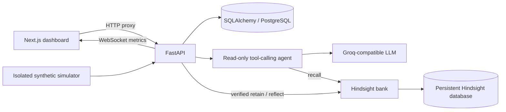

# J76 IncidentMind

**The AI Engineer That Never Forgets a Problem.**

**Live demo:** [j76-incidentmind.jjgowda76.workers.dev](https://j76-incidentmind.jjgowda76.workers.dev) · [Deployment guide](docs/CLOUDFLARE.md)

The hosted demo requires sign-in. Credentials are kept in a private local access file and are not published in this repository.

A functional hackathon application for investigating incidents with a read-only LLM agent, verifying fixes, and retaining operational learning in **real Hindsight persistent memory**. Built for HackwithHyderabad 3.0.

Next.js App Router · TypeScript · Tailwind CSS · shadcn-style source-owned Button/Radix · Lucide · Recharts · FastAPI · SQLAlchemy · PostgreSQL · WebSockets · Groq-compatible LLM · Hindsight official Python SDK.

## Cloudflare hosting

Production publishing uses **Workers + D1**, as approved for the Cloudflare deployment. The existing Python/PostgreSQL stack remains available locally; production uses a TypeScript API Worker with the same incident workflows and real Groq/Hindsight APIs. See [Cloudflare deployment](docs/CLOUDFLARE.md) for resources, commands, private service routing and demo sign-in.

## Quick start (local)

Requirements: Node.js 22+, Python 3.11–3.13, and a real Hindsight server or Cloud account. Docker is optional for local development. SQLite is used only for **application incident storage** in the local quick start; memory always uses Hindsight.

```bash
cp .env.example .env
python3 -m venv .venv
source .venv/bin/activate
pip install -r backend/requirements.lock.txt
npm ci --prefix frontend
```

Edit `.env` with your provider credentials. Start the backend from the repository root:

```bash
source .venv/bin/activate
uvicorn backend.main:app --reload --host 127.0.0.1 --port 8000
```

In another terminal:

```bash
npm run dev --prefix frontend
```

Open [the dashboard](http://localhost:3000), [API documentation](http://localhost:8000/docs), or [health check](http://localhost:8000/api/health). The simulator, incident storage, verification and history work before AI credentials are configured. AI/memory calls report explicit service errors rather than fake answers.

The frontend proxies HTTP to `127.0.0.1:8000`. To override it, set `BACKEND_URL` in `frontend/.env.local`. If overriding the browser WebSocket address, set `NEXT_PUBLIC_WS_URL` there too and restart/rebuild Next.js. Root `.env` is for Python and Docker Compose, not automatically loaded by Next.js.

## Docker Compose / PostgreSQL

Install Docker Desktop, copy/edit `.env`, then:

```bash
docker compose up --build
# Wait for Hindsight to initialize models and its embedded PostgreSQL.
docker compose exec backend python -m backend.memory.setup_bank
```

Application PostgreSQL and Hindsight's embedded PostgreSQL use separate named volumes. `docker compose down` preserves both; `docker compose down -v` deletes them. Hindsight's image follows the upstream `latest` tag: pin the tested digest before a reproducible hosted deployment.

## Connect Hindsight and the LLM

- `LLM_API_KEY`: your Groq key (or another compatible provider's key).
- `LLM_BASE_URL`: defaults to `https://api.groq.com/openai/v1`.
- `LLM_MODEL`: defaults to `openai/gpt-oss-120b`; choose a model supporting tools and JSON object responses.
- `HINDSIGHT_URL`: local `http://localhost:8888`, or your Cloud API URL.
- `HINDSIGHT_API_KEY`: Cloud bearer token, or blank for unauthenticated local Hindsight.
- `HINDSIGHT_BANK_ID`: dedicated persistent bank, defaults to `j76-incidentmind`.
- `DATABASE_URL`: local SQLite default or `postgresql+psycopg://...`.
- `PROVIDER_TIMEOUT`, `CORS_ORIGINS`: optional; see `.env.example`.

Self-hosted Hindsight also needs its **own** extraction/reflection LLM key: `HINDSIGHT_API_LLM_PROVIDER`, `HINDSIGHT_API_LLM_API_KEY`, `HINDSIGHT_API_LLM_MODEL`. This can use the same account, but is a separate configuration from the investigator.

Provision the bank once after Hindsight starts:

```bash
source .venv/bin/activate
python -m backend.memory.setup_bank
```

See the [official Python SDK](https://hindsight.vectorize.io/sdks/python), [Hindsight installation](https://hindsight.vectorize.io/developer/installation), and [Groq API reference](https://console.groq.com/docs/api-reference). Integration uses documented `retain`, `recall`, and `reflect`; it has no local-memory substitute.

## Demonstrate the complete learning cycle

1. Click **Simulate incident**, select **Product images unavailable**, and generate the first incident.
2. Inspect synthetic logs. Disable Memory for this first run; click **Investigate with AI**.
3. Read the ranked hypotheses. Open the simulator answer key for the developer's known cause; it is excluded from AI input.
4. Record the confirmed cause, applied fix, verification evidence, lessons, and any failed attempts. Check **Resolution successful** and record verification. This is a human attestation; IncidentMind does not actually change Cloudflare or execute a fix.
5. Click **Save learning to Hindsight**. Wait for a successful retain. Use **Memory Explorer** to recall the incident and inspect source metadata.
6. Generate another image failure with **Recurring variant** enabled. Its symptoms differ, while its known cause is the same.
7. Open **Comparison Lab**, select the recurring incident and run comparison. Compare the actual OFF/ON diagnoses, recall source IDs, memory influence, checks, and duration. Both runs use the same evidence, model, temperature, system prompt, and read-only tools; only historical memory differs.
8. Restart the backend and Hindsight without deleting volumes. Recall again to demonstrate persistence.

There is no promise that memory makes a particular run faster or better. Exact-cause text matching is conservative; non-matches require manual assessment. Use the Reviewer assessment form to save observed cause rank, fix correctness, and qualitative explanation quality with notes. These are labeled human assessments; no numerical quality or accuracy score is invented.

## Validation

```bash
source .venv/bin/activate
python -m pytest backend/tests -q
npm run build --prefix frontend
npm run typecheck --prefix frontend
# Opt-in integration test: makes real calls and creates a dedicated test bank.
RUN_LIVE_HINDSIGHT=1 python -m pytest backend/tests/test_hindsight.py -k live -s
```

The live test verifies retain, recall from a new SDK client, and reflect. It leaves a uniquely named bank for inspection. To prove restart persistence, also perform the explicit restart step in the demo guide. Unit tests use provider doubles and do not establish live connectivity.

## Architecture and scope



Read [architecture and integration](docs/ARCHITECTURE.md), [API guide](docs/API.md), [demo guide](docs/DEMO.md), [troubleshooting](docs/TROUBLESHOOTING.md), and [submission checklist](docs/SUBMISSION_CHECKLIST.md).

This is a local single-workspace hackathon MVP. It has no authentication or tenant isolation, so do not expose the backend publicly without adding them. Simulator failures are synthetic evidence; they do not change infrastructure. Secrets stay in server environment variables. Band AI Desktop can run the same repository commands; there is no dependency on an editor-specific API or a claimed Band certification.
